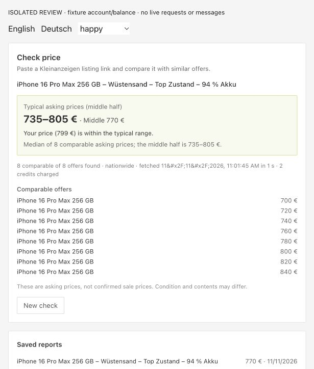
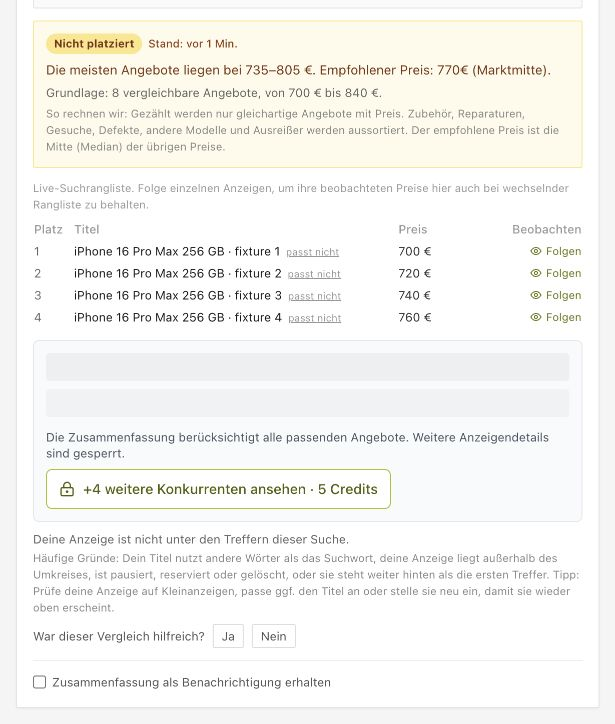

# Kleinanzeigen Market Intelligence

Tools for exploring **asking prices** and evaluating product matching and price estimates in secondhand marketplaces. Independent research by [AnzeigenBoost](https://anzeigenboost.de/).

**Deutsch:** Dieses Projekt bietet Werkzeuge für Marktanalysen und KI-Bewertungen. Die Beispieldaten sind künstlich erstellt – sie zeigen keine tatsächlichen Marktpreise. [Deutsche Einführung](README.de.md).

> **Data status:** The included datasets and screenshots use fictional fixture data. They are not real listings, market findings, sales prices or model benchmark results.

## Explore the tools

| Tool | What it does | Try it |
| --- | --- | --- |
| Asking-price analysis | Count, median and 25th/75th percentiles by category | [Sample CSV](examples/asking-prices.synthetic.csv) |
| Price-estimate evaluation | MAE, median error, MAPE and over/underestimates | [Sample CSV](examples/price-predictions.synthetic.csv) |
| Product-matching evaluation | Precision, recall, F1 and confusion counts | [Sample CSV](examples/matching-predictions.synthetic.csv) |
| Matching examples | Same, different and ambiguous product variations | [Golden dataset](datasets/golden/) |

Runs locally with Python 3.10+ and the standard library. No account, API key, network requests or scraping are needed.

## See the product

These screenshots show the **AnzeigenBoost extension**, not a user interface provided by this repository. Both were captured from fixture-based review screens; the listings, prices and results are illustrative. Features and credit requirements may change.

<details>
<summary><strong>Price check — comparable asking prices</strong></summary>



</details>

<details>
<summary><strong>Competitor check — example offers</strong></summary>



</details>

## Quick start

Clone the repository and run an example from its root:

```sh
git clone https://github.com/Rebaiahmed/kleinanzeigen-market-intelligence.git
cd kleinanzeigen-market-intelligence
python -m market_intelligence.cli asking-prices examples/asking-prices.synthetic.csv
```

The output is JSON with a count, median and quartiles for each category. **The values in the example are invented**, so they must not be presented as real-world findings.

More examples:

```sh
python -m market_intelligence.cli prices examples/price-predictions.synthetic.csv
python -m market_intelligence.cli matching examples/matching-predictions.synthetic.csv
python -m unittest discover -s tests -v
```

JSON arrays are also supported; equivalent `.json` files are alongside the CSV examples.

## Use your own data

Save a UTF-8 CSV with a header row and select the matching command:

| Command | Required columns | Notes |
| --- | --- | --- |
| `asking-prices` | `category`, `asking_price_eur` | A category and a non-negative asking price in euros |
| `prices` | `reference`, `predicted` | Non-negative numeric reference and estimate |
| `matching` | `label`, `predicted` | Boolean `true` or `false` for each |

For example: `python -m market_intelligence.cli asking-prices my-data.csv`. Extra columns are ignored. Input prices must be finite and non-negative. Zero-reference rows are excluded from MAPE and reported separately. Undefined classification metrics are `null`. Ambiguous examples are stored separately and should not be treated as negative matches.

Only use data you have the right to collect and process. Asking prices are not transaction prices, and a sample may not represent the market. See [dataset provenance](datasets/README.md) and [methodology](docs/methodology.md).

## Data and roadmap

The fictional examples cover smartphones, gaming and furniture. There are no rights-cleared real datasets, independently verified benchmark results, or model comparisons in this release. Listing-optimization evaluation, licensed data and broader categories are future work. The workflow is **CSV or JSON → offline Python analysis → JSON results**.

## About AnzeigenBoost

[AnzeigenBoost](https://anzeigenboost.de/) is a Chrome extension designed to help Kleinanzeigen sellers optimize listings, compare competitors and prices, schedule reposts and improve selling workflows. Availability can vary by account or feature settings.

**Want to use these insights when selling on Kleinanzeigen? [Explore AnzeigenBoost](https://anzeigenboost.de/).**

[Chrome Web Store](https://chromewebstore.google.com/detail/noagiapohlenpolcbeghlmngalapbobe) · [Product guide](https://anzeigenboost.de/ratgeber/anzeige-als-vorlage-speichern)

This is an independent research and engineering initiative by AnzeigenBoost. It is not affiliated with, endorsed by, or operated by Kleinanzeigen. Product and brand names belong to their respective owners.

## Contributing and license

Read [CONTRIBUTING.md](CONTRIBUTING.md) and [SECURITY.md](SECURITY.md) before contributing. Do not share personal data, private listings or third-party material without documented rights. Original code and synthetic fixtures are available under the [MIT License](LICENSE).
